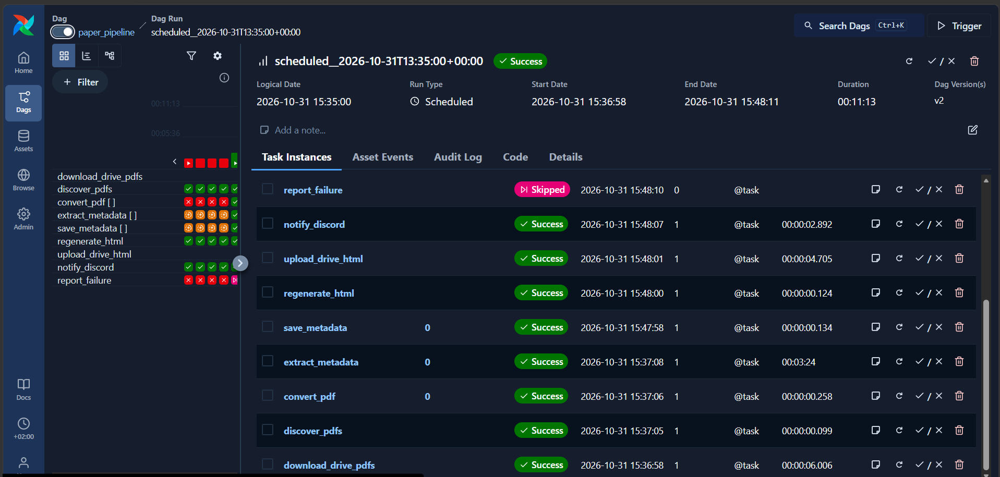
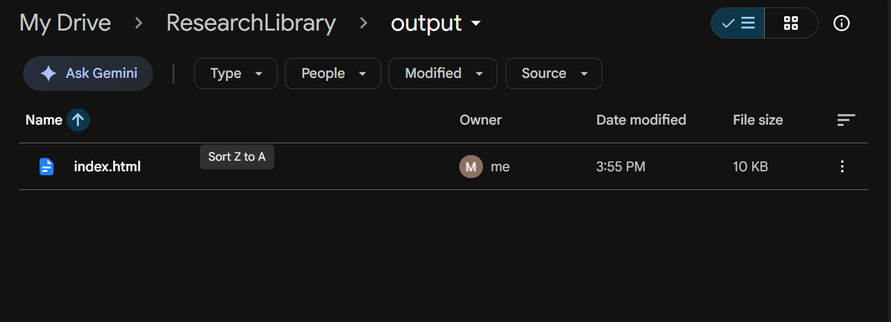
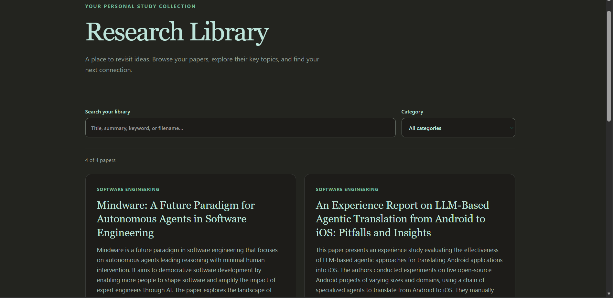
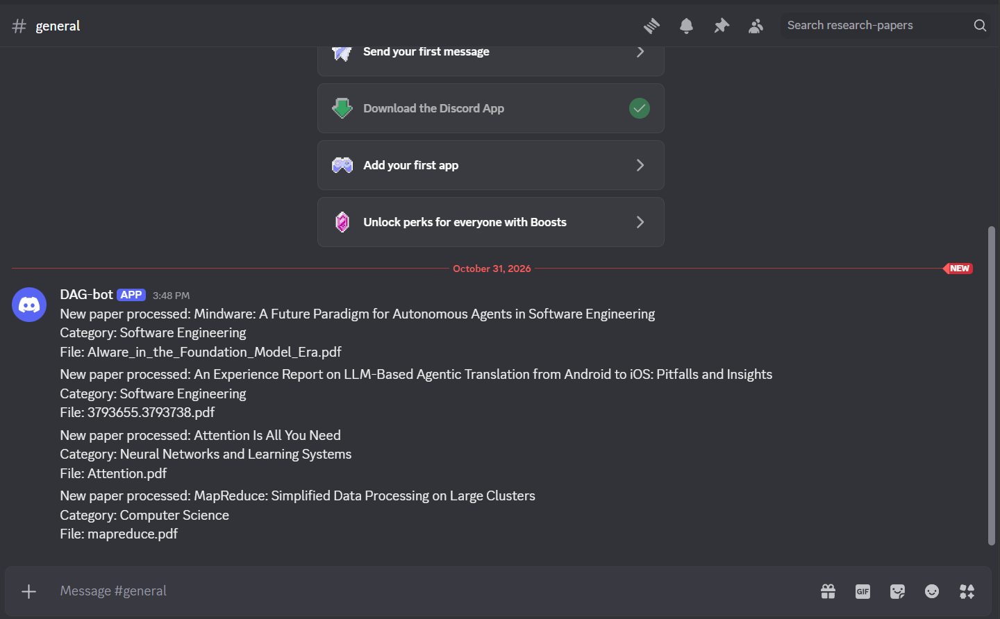

# Local Research Paper Library with Airflow
*Technical Report — INFO-H420, Assignment 3*

**Author:** Mustafa Tarek
**Repository:** [MustafaTarek77/research-library](https://github.com/MustafaTarek77/research-library)

A single-machine pipeline converts research PDFs into a searchable study library.
Apache Airflow orchestrates PDF conversion, local LLM inference, metadata storage,
HTML generation, Google Drive transfers, and Discord notifications. The processing
logic is implemented in Python and runs in Ubuntu through WSL2.

**Result:** the complete Drive-to-Discord run succeeded for two new PDFs. The
library contained four stored papers, and four pending notifications were
confirmed. Subsequent runs found no new inputs and completed without repeating
inference or notification delivery.

## 1. ARCHITECTURE AND DESIGN

The `paper_pipeline` DAG runs through `airflow standalone` on a five-minute
schedule. It contains nine task definitions. Conversion, extraction, and storage
are dynamically mapped over the new papers discovered at runtime; a failure
watcher is connected to every stage. Both DAG concurrency and executor
parallelism are limited to one task, allowing CPU inference to run without
competing requests.

```text
                       Google Drive: ResearchLibrary
                       papers/                output/index.html
                          |                          ^
                    rclone download             rclone upload
                          |                          |
                          v                          |
                    Local papers/                    |
                          |                          |
                  Discover new PDFs                  |
                          |                          |
                  PDF -> Markdown                    |
                          |                          |
                Local Ollama inference               |
                          |                          |
                Parse and validate JSON               |
                          |                          |
                  Local SQLite database               |
                          |                          |
                   Generate index.html ---------------+
                                                     |
                                              Discord webhook

  Airflow schedules the stages, captures their logs, and manages retries.
  SQLite, intermediate files, OAuth tokens, and Airflow state stay local.
```

*Figure 1. Logical architecture. Airflow coordinates execution; the failure
watcher's monitoring connections are omitted for clarity.*

**Key design choices.** PyMuPDF4LLM produces Markdown for text-based PDFs. Ollama
serves `qwen2.5:1.5b` with Q4_K_M quantization locally; the native HTTP API provides
JSON-schema output and inference timing counters. Python parses the response
with `json.loads()` and checks the required title, summary, keywords, and
category fields. SQLite provides transactional persistence with a unique filename
key. A static HTML page supplies browser-side search, category filtering, and
relative PDF links without a separate application server.

Drive integration uses non-deleting rclone operations: `copy` downloads PDFs
before discovery, and `copyto` uploads only the generated page after publication.
Discord delivery follows a successful upload. Desktop-synced folders use the same
processing pipeline with rclone disabled. Folder paths and runtime settings are
configured in `.env`; Windows paths are translated into WSL paths.

## 2. STATE, RETRIES, AND OBSERVABILITY

The application database, `data/papers.db`, stores paper metadata, the source
checksum, processing time, and notification confirmation time. Airflow's separate
database records DAG runs and task states. Intermediate Markdown and validated
JSON are written atomically and retained as checkpoints. A retry of a completed
save cannot insert a duplicate record, and a later publication or notification
failure does not require another LLM call.

Discovery skips stored filenames, defers empty or recently modified files for ten
seconds, and checks the source checksum before and after conversion. Invalid
model output receives one additional request. Other stages retry once after
30 seconds. Publication can include successful database commits when another
paper fails, while the failure watcher preserves an overall failed DAG status.
A failed Drive download blocks the upload and notification stages.

Discord uses `wait=true` and records `notified_at` only after message creation is
confirmed. Confirmed notifications are skipped on later runs. A crash after
Discord accepts a message but before SQLite records the confirmation can still
cause a duplicate; delivery is not exactly-once across the two systems.

Application logs identify stage transitions and filenames. During inference,
15-second heartbeats report elapsed time. Airflow adds run, task, mapped index,
and attempt information. These logs distinguish an empty scan, an active LLM
request, a task failure, and a task waiting for the scheduler.

## 3. EXECUTION AND RESULTS

The evaluated run was `scheduled__2026-10-31T13:35:00+00:00`, with execution from
13:36:58 to 13:48:11 UTC. It imported two previously unprocessed PDFs from Drive.
All eleven processing task instances succeeded; the twelfth instance, the
failure watcher, was correctly skipped.

| Input | Pages | Prompt tokens | Extraction task duration | Result |
| --- | ---: | ---: | ---: | --- |
| `3793655.3793738.pdf` — Android-to-iOS agentic translation experience report | 11 | 15,951 | 204.19 s | Metadata validated and stored |
| `AIware_in_the_Foundation_Model_Era.pdf` | 5 | 1,732 | 21.84 s | Metadata validated and stored |

Both responses passed JSON validation on the first attempt. The generated page
contained four papers: the two new inputs and the previously stored MapReduce
and Attention papers. Drive upload succeeded, and the Discord task confirmed
four pending notifications, including the two earlier papers' backlog.

The run's wall time was **673.06 seconds**, including time when the DAG was
manually paused. The sum of successful task execution durations was **240.57
seconds**, measured from Airflow task start/end timestamps. Wall time therefore
includes an operator delay and should not be used
as an uninterrupted processing-throughput measurement. Follow-up scheduled runs
completed in **9.93 seconds** and **12.13 seconds**, with no new inputs or repeated
LLM work. All four database records had notification confirmation timestamps.

The CPU baseline used an AMD Ryzen 9 5900HX, eight inference threads, a
32,768-token context, and a 512-token output limit. The earlier full-paper
MapReduce benchmark took approximately **141 seconds** for conversion plus first
inference and used approximately **2 GiB** for the model process. Zero GPU memory
was allocated. Repeated requests took about ten seconds because their prompt was
cached; those values do not represent processing a new paper.

The automated suite contains **35 passing tests**, covering metadata validation,
bounded retries, duplicate prevention, checkpoint reuse, source changes, HTML
escaping, environment loading, Windows path conversion, Drive transfer boundaries,
and notification recovery. A separate invalid-PDF run confirmed that conversion
failure remains visible in the DAG even when HTML publication succeeds.

## 4. LIMITATIONS AND REPRODUCTION

Schema-constrained JSON controls structure, not factual accuracy. The small model
produced a correct title for the translation report but incorrectly renamed the
AIware input to “Mindware: A Future Paradigm for Autonomous Agents in Software
Engineering.” Basic validation accepted this because it checks field presence and
types. Source-grounded title extraction and semantic checks are therefore useful
future improvements; generated metadata must be reviewed against the PDF.

Initial scope covers text-based PDFs that fit the configured context. Scanned
documents need OCR, and longer papers need a chunking strategy. Filenames are
treated as unique, append-only identifiers. Local-only papers must also be placed
in Drive if their PDF links are to be available to someone downloading the shared
library. OAuth tokens and webhook credentials remain outside version control.

The repository README contains installation, startup, configuration, and test
commands. The workflow runs with `scripts/serve_cpu.sh` and
`scripts/start_airflow.sh`; `scripts/show_progress.py` follows application events.
The implementation, configuration template, test suite, and supporting execution
evidence are available in the linked repository.

<!-- pagebreak -->

## APPENDIX A. WORKFLOW AND DRIVE EVIDENCE



*Figure 2. Successful Drive-to-Discord run, including extraction, storage,
publication, and notification. The failure watcher is intentionally skipped.
Dashboard timestamps use UTC+02:00; the run identifier uses UTC.*



*Figure 3. The generated index.html uploaded to ResearchLibrary/output in Google
Drive. SQLite, intermediate files, credentials, and model weights remain local.*

<!-- pagebreak -->

## APPENDIX B. LIBRARY AND NOTIFICATION EVIDENCE



*Figure 4. The generated page lists four papers and provides search and category
filtering. The model-generated AIware title illustrates the quality limitation
discussed in Section 4.*



*Figure 5. DAG-bot notifications for both new inputs and the previously stored
Attention and MapReduce papers. Delivery confirmation is recorded in SQLite.*

Additional run-history evidence is available in
[screenshots/02-airflow-runs.png](../screenshots/02-airflow-runs.png).
